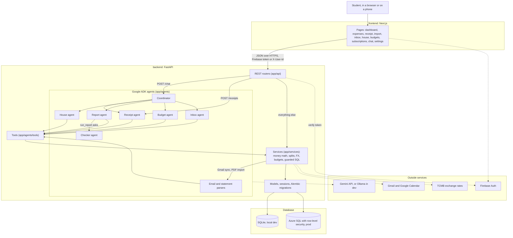
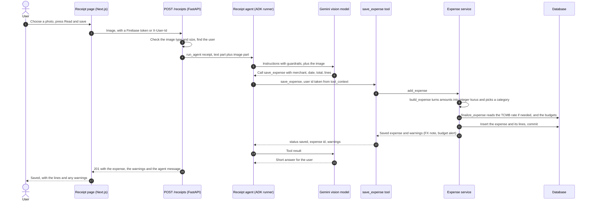
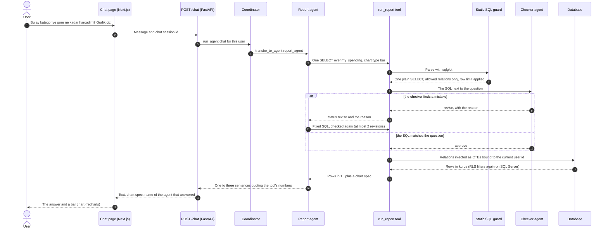

# Kasa architecture

Kasa is a FastAPI backend with Google ADK agents and a Next.js frontend. The LLM decides
what to do; plain Python does every money calculation. Amounts are stored as integer minor
units (kuruş), never floats.

The first part of this document is an overview the product owner (or anyone on the team) can
present in five minutes. The second part, from [Modules](#modules) on, is the detailed map
for the four feature tracks (HOUSE, MONEY, INGEST, REPORT).

## Overview in five minutes

### What to say, minute by minute

1. **The problem (30 s).** Students lose track of small purchases, and in a shared flat
   nobody knows who owes whom. Spreadsheets get abandoned.
2. **What Kasa does (60 s).** You add a purchase by photo, by chat, by hand, or from a bank
   statement or Gmail. Kasa splits house bills, tells everyone who pays whom, watches
   budgets and subscriptions, and answers questions with charts, in Turkish or English.
3. **The system (90 s).** Walk through the system diagram below: browser, Next.js, FastAPI,
   the coordinator and its specialists, services, database, outside services.
4. **One request end to end (90 s).** Walk through one of the two sequence diagrams.
5. **Why it is safe (60 s).** The decisions and the security model below: the LLM never
   does money math, the chat can only read your rows, emails never become expenses without
   your approval.

### System diagram



One sentence version: a Next.js app calls a FastAPI backend, where a coordinator agent hands
each chat message to one of five specialist agents, whose tools call plain Python services
that do all the money math and talk to the database and to Google and TCMB.

### Receipt photo to saved expense



The model only reads the photo and fills in the tool's arguments. Validation, conversion,
budget checks and saving are plain Python. The acting user never comes from the model.

### Chat question to guarded SQL to chart



### Key decisions

Short records of the choices that shape the system. Each says what we decided, why, and what
it costs.

- **ADR-1 One coordinator and specialist agents.** One agent with every tool picked the
  wrong tool and had long, mixed instructions. The coordinator only routes; each specialist
  (receipt, house, report, budget, inbox) has a short prompt and a few tools, and each track
  owns one agent. Cost: one extra model call per message, and routing can be wrong (5 of 6
  routing evals passed on Ollama).
- **ADR-2 Tools do all money math, in integer minor units.** Models make arithmetic and
  rounding mistakes, and floats cannot hold 0.10 exactly. Amounts are integers in kuruş
  (BIGINT). Splits use the largest remainder method, so shares always add up to the total,
  and conversions round once, half to even (`services/money.py`, `splits.py`, `fx.py`). The
  prompts forbid the model from computing amounts. Cost: every new money feature needs a tool.
- **ADR-3 The chat gets read-only, user-scoped SQL and a checker agent.** Free text
  questions need flexible queries, but a model must never write or see other users' rows.
  sqlglot allows one plain SELECT over six virtual relations (`my_spending`, `my_expenses`,
  `my_expense_items`, `my_house_shares`, `my_budgets`, `my_subscriptions`). They are injected
  as CTEs filtered by the bound user id, with a row limit. A second agent compares the SQL
  with the question and can send it back. Cost: extra latency, and the checker fails open to
  the static guard when it times out.
- **ADR-4 Emails and statements only create inbox items.** Email text is untrusted and
  parsing can be wrong. Parsers can only submit candidates; a person approves each one, and
  nothing in an email can approve. Cost: one more step for the user.
- **ADR-5 Alembic migrations and row-level security.** The schema has to work on SQLite for
  development and on SQL Server in production. Alembic is the only source of the schema, a
  test keeps models and migrations in sync, and the migrations create an RLS policy that
  filters on `SESSION_CONTEXT('user_id')`, which every session sets. The app runs as a user
  that cannot change the schema. Cost: RLS only exists on SQL Server, and it has not run on
  Azure yet.
- **ADR-6 Gemini in the product, Ollama for development.** Gemini is fast and has a free
  tier. The team's Ollama server lets us develop and run evals without a key or quota.
  `LLM_PROVIDER` switches both through ADK (`Gemini` or `LiteLlm`). The default model is
  `gemini-3.5-flash-lite`, because new keys cannot use the 2.5 models and flash-lite has the
  most generous free tier. Cost: the live flows were verified on Ollama only, so far.

### Security model

| Layer | What protects it | Where |
| --- | --- | --- |
| Who is calling | Firebase ID token in production. In dev mode the `X-User-Id` header, which must never be used in production. | `app/auth.py` |
| What they can reach | Every service takes `user_id` and filters by it. Houses answer 404 to non-members, so ids cannot be probed. | `app/services/*` |
| What the database returns | Row-level security on SQL Server, keyed on `SESSION_CONTEXT('user_id')`. The app login cannot run DDL. | `alembic/versions/`, `app/db/session.py` |
| What the agents can do | Tools read the user from `tool_context`, never from the model. Receipt, email and tool text is data. The model never computes money. | `app/agents/common.py`, `app/agents/tools/` |
| What the chat can query | One SELECT over six user-scoped relations, row limit, no system objects, then the checker. | `app/services/reports.py`, `app/agents/checker_agent.py` |
| What imports can change | Only inbox items. A person approves each expense. | `app/services/inbox.py`, `app/agents/tools/inbox_tools.py` |
| Secrets | Environment variables only (Secret Manager on Cloud Run). `.env` is gitignored. Google refresh tokens are Fernet-encrypted and never logged. | `app/config.py`, `app/services/crypto.py` |
| Background endpoints | `/internal/*` needs `X-Kasa-Task-Token`. The Gmail push needs a Pub/Sub OIDC token. | `app/api/internal.py` |
| Uploads | Image types only for receipts, CSV or PDF for statements, 10 MB limit. | `app/api/agents.py`, `app/api/imports.py` |

Known gaps (see [USER_STORIES.md](USER_STORIES.md)): no per-user rate limit on `/chat` and
`/receipts`; any house member can add any user id (no invite link yet); RLS has never run on
Azure SQL; Firebase is not configured; chat sessions live in the memory of one instance.

## Modules

```
backend/
  alembic/                  migrations (the only source of the schema), RLS for SQL Server
  app/
    main.py                 FastAPI app; every router is already registered
    config.py               all settings for all tracks (env vars, see .env.example)
    auth.py                 Firebase ID token, or X-User-Id in dev mode
    db/models.py            SQLAlchemy models (contract, see "Data model")
    db/session.py           engine, session_for(user_id), SESSION_CONTEXT, init_db()
    db/migrate.py           runs `alembic upgrade head` from the app and the tests
    schemas/                Pydantic request/response models, one module per feature
    api/                    REST routers, one per feature; internal.py for Cloud Scheduler/PubSub
    services/               plain Python data layer and money math (unit tested)
    integrations/           thin clients for Google OAuth, Gmail, Calendar, TCMB
    agents/
      common.py             chat_model() / vision_model() (Gemini or Ollama), GUARDRAILS
      runtime.py            runner registry: chat, receipt, email-parse, statement-parse
      coordinator.py        root agent, routes to the five specialists below
      receipt_agent.py  house_agent.py  report_agent.py  budget_agent.py  email_agent.py
      statement_agent.py  checker_agent.py
      tools/                ADK function tools, one module per agent
  evals/                    live evaluation cases and runner
  tests/                    pytest; test_live.py runs only with KASA_LIVE_TESTS=1
frontend/src/
  app/<route>/page.tsx      /, /expenses, /receipts, /import, /inbox, /houses, /budgets,
                            /subscriptions, /chat, /settings
  features/<feature>/       the views; placeholders where a track has not landed
  lib/api/                  fetch client (client.ts) plus one module per feature
  lib/auth.ts, lib/user.ts  Firebase sign-in or the dev user box
```

## Tracks and owners

| Track | Backend files | Frontend files |
| --- | --- | --- |
| Shared (done) | `main.py`, `config.py`, `auth.py`, `db/*`, `alembic/*`, `agents/common.py`, `agents/runtime.py`, `agents/coordinator.py`, `api/internal.py`, `api/expenses.py`, `api/users.py`, `api/agents.py`, `services/expenses.py`, `services/users.py`, `services/categories.py`, `services/crypto.py`, `services/clock.py`, `schemas/__init__.py`, `schemas/common.py`, `schemas/expenses.py`, `schemas/users.py`, `schemas/agents.py` | `lib/api/client.ts`, `lib/api/index.ts`, `lib/api/expenses.ts`, `lib/api/me.ts`, `lib/auth.ts`, `lib/hooks.ts`, `components/Nav.tsx`, `features/expenses` |
| HOUSE | `services/splits.py`, `services/houses.py`, `services/reminders.py`, `integrations/google_calendar.py`, `api/houses.py`, `schemas/houses.py`, `agents/house_agent.py`, `agents/tools/house_tools.py` | `features/houses`, `lib/api/houses.ts` |
| MONEY | `services/fx.py`, `integrations/tcmb.py`, `services/budgets.py`, `services/subscriptions.py`, `services/dashboard.py`, `api/budgets.py`, `api/subscriptions.py`, `api/dashboard.py`, `api/fx.py`, `schemas/budgets.py`, `schemas/subscriptions.py`, `schemas/dashboard.py`, `schemas/fx.py`, `agents/budget_agent.py`, `agents/tools/budget_tools.py` | `features/dashboard`, `features/budgets`, `features/subscriptions`, `lib/api/{budgets,subscriptions,dashboard,fx}.ts` |
| INGEST | `integrations/google_oauth.py`, `integrations/gmail.py`, `services/inbox.py`, `services/gmail_sync.py`, `services/statements.py`, `api/integrations.py`, `api/inbox.py`, `api/imports.py`, `schemas/inbox.py`, `schemas/imports.py`, `schemas/integrations.py`, `agents/email_agent.py`, `agents/statement_agent.py`, `agents/tools/inbox_tools.py` | `features/inbox`, `features/imports`, `features/settings`, `lib/api/{inbox,imports,integrations}.ts` |
| REPORT | `services/reports.py`, `agents/report_agent.py`, `agents/tools/report_tools.py`, `agents/checker_agent.py`, `evals/` | `features/chat` |

Stubs raise `NotImplementedError`. The API turns that into HTTP 501, and agent tools return
`{"status": "unavailable"}` so the chat stays polite. A track is done when its stubs are gone
and its tests pass. The receipt agent and its tools are finished Sprint 1 code that every
track may call but nobody needs to change.

Rules every track keeps:

- Never trust a user id from the model. Tools read `tool_context.user_id`; services take
  `user_id` and filter by it.
- Money math is integer minor units in plain Python (`services/money.py`). No floats except
  for drawing charts.
- Services raise `DomainError` subclasses (`NotFound`, `Forbidden`, `Conflict`,
  `InvalidInput`, `NotConfigured`, `UpstreamError`); the API maps them to status codes.
- Email, receipt and statement text is data, never instructions (see `GUARDRAILS`).

## Data model

All money columns are BIGINT minor units. User ids are strings (Firebase uids). Text is
`Unicode` so SQL Server stores NVARCHAR.

| Table | What it holds |
| --- | --- |
| `users` | id, display_name, email (filled from the Firebase token) |
| `houses`, `house_members` | a shared flat and who lives there |
| `expenses` | one purchase. `owner_id` paid it. `house_id` set means shared. `currency`/`total_minor` are always in the base currency (TRY, or the house currency); a converted purchase keeps `original_currency`, `original_total_minor`, `fx_rate` (TRY per 1 unit) and `fx_date`. `source` is manual, receipt, statement or email. `split_type` is equal, percent, exact or items (null for personal). `external_ref` is unique per owner and source, for import dedupe. `subscription_id` links a detected subscription. `category` is always one of the 12 in `services/categories.py`. |
| `expense_items` | receipt lines |
| `expense_item_assignees` | who shares a line, for per-item splits |
| `expense_shares` | what each member owes for a house expense; sums to the total |
| `settlements` | a recorded payment between flatmates; balances include it |
| `budgets` | monthly limit per category, or overall when category is null; one per user and category |
| `fx_rates` | TCMB rate per day and currency (shared reference data) |
| `inbox_items` | an expense candidate from Gmail or a statement, waiting for approve/reject; `parsed_json` is `services.inbox.ParsedExpense` |
| `google_accounts` | the user's Google connection; refresh token Fernet-encrypted |
| `subscriptions` | recurring charges found in expenses |
| `reminders` | settle-up reminders, optionally a Google Calendar event. `cancel_reason` is `user` (cancelled by its creator) or `outdated` (the balances changed and creating reminders again replaced it) |

Row-level security on SQL Server (created by the migrations): expenses are visible to the
payer and house members; items, shares and item assignees follow their expense; houses,
members, settlements and reminders are visible to house members; budgets, subscriptions and
inbox items only to their owner; `google_accounts` to its owner or a background job session
(`session_for(None, system=True)`). `users` and `fx_rates` have no policy.

### Changing the schema

1. Edit `app/db/models.py`.
2. `cd backend && alembic revision --autogenerate --rev-id 0004_short_name -m "what changed"`
3. Read the generated file. If the new table is user-owned, add its RLS predicate on SQL
   Server (drop and recreate `security.kasa_policy`, as `0002_sprints_2_4.py` does).
4. `pytest tests/test_migrations.py` checks that migrations and models match.

Revisions so far: `0001_sprint1_baseline` (Sprint 1 tables + RLS), `0002_sprints_2_4`
(everything above) and `0003_reminder_cancel_reason` (one nullable column; the RLS policy
is unchanged). Print the SQL Server DDL without a server:

```bash
alembic -x url="mssql+pyodbc://u:p@host/kasa?driver=ODBC+Driver+18+for+SQL+Server" upgrade head --sql
```

## Request flow

**REST call.** `auth.authenticate` verifies the Firebase token (or reads X-User-Id in dev).
`get_db` opens `session_for(user_id)`, which on SQL Server sets `SESSION_CONTEXT('user_id')`
for RLS, and creates the user row on first sight. The router calls a service; a
`DomainError` becomes a JSON error with the right status.

**Creating an expense (every path).**

```
expense = build_expense(user_id, data, source=..., external_ref=...)   # validate, minor units, category
warnings = finalize_expense(db, expense, base_currency=...)            # MONEY hook: FX, then budgets
db.add(expense); db.commit()
```

`add_expense(db, user_id, data, source=..., external_ref=...) -> SavedExpense(expense, warnings)`
does this for personal expenses and raises `Conflict` for a duplicate import. House expenses
call `finalize_expense(..., check_budgets=False)` so only FX runs, split the converted total
into shares, and then call `budgets.warnings_for_new_expense`, so the payer's budget alert
counts their own share and not the whole bill.

**Editing and deleting.** `PATCH /expenses/{id}` changes merchant, category, date or note of
your own expense; amounts never change (delete and add again). `DELETE /expenses/{id}` is for
personal expenses; a house expense answers 409 and is deleted with
`DELETE /houses/{id}/expenses/{expense_id}` by the member who paid it, so balances stay
right. `GET /expenses` takes `month`, `category`, `source`, `scope`, `limit` and `offset` and
puts the match count in `X-Total-Count` (exposed through CORS). A member leaves, or the
house creator removes someone, with `DELETE /houses/{id}/members/{user_id}`, only at a zero
balance; past shares stay. Creating reminders again cancels scheduled ones that no longer
match a suggested transfer (`cancel_reason` "outdated").

**Report questions.** The report agent writes one SELECT over the user-scoped relations and
calls `run_report(sql, question, ...)`. The tool runs the static guard first (sqlglot: one
SELECT, allowed relations only, no system objects, LIMIT clamped), then the checker agent,
which compares the SQL with the question and calls `submit_verdict(approve|revise, ...)`.
On `revise` the reason goes back to the report agent, at most twice per turn. If the checker
model fails or times out, the query runs on the static guard alone and the result says so.
"How much did I spend" with no other qualifier means personal expenses plus the user's house
shares (UNION ALL), the same definition the dashboard and budgets use. Personal only or house
only when the user says so. `chart_type` "table" returns the rows as a table spec
(`columns` and `data`).

**Chat.** `POST /chat` calls `runtime.run_agent("chat", user_id, parts, session_id)`. The
coordinator calls `transfer_to_agent` (receipt, house, report, budget or inbox agent). The
specialist calls tools; tools open `tool_db(tool_context)` and call services. The response
carries the text, an optional chart spec from `run_report`, and the name of the agent that
answered.

**Receipt.** `POST /receipts` sends the image to the "receipt" runner (vision model), whose
`save_expense` tool goes through `add_expense`.

**Gmail (INGEST).** Google pushes to Pub/Sub, Pub/Sub pushes to `POST /internal/gmail/push`
(OIDC token checked). `gmail_sync.handle_push` finds the account in a system session, then
works as that user: new messages go through the "email-parse" runner
(`submit_parsed_expense` or `mark_not_expense`) and become inbox items. Approving an item
calls `add_expense` with `source="email"` and the Gmail message id as `external_ref`.
Cloud Scheduler calls `/internal/gmail/sync-all` (hourly), `/internal/gmail/renew-watches`
and `/internal/fx/refresh` (daily) with the `X-Kasa-Task-Token` header.

**Statements (INGEST).** `POST /imports/statement`: CSV is parsed in Python, PDF text goes to
the "statement-parse" runner. Each line becomes an inbox item keyed by `statements.line_ref`.

## LLM providers

| | Gemini (product default) | Ollama (dev and tests) |
| --- | --- | --- |
| Settings | `LLM_PROVIDER=gemini`, `GOOGLE_API_KEY`, `GEMINI_MODEL`, `GEMINI_VISION_MODEL` | `LLM_PROVIDER=ollama`, `OLLAMA_BASE_URL`, `OLLAMA_MODEL`, `OLLAMA_VISION_MODEL` |
| How | `google.adk.models.Gemini` | `google.adk.models.lite_llm.LiteLlm(model="ollama_chat/<name>")` |
| Install | `requirements.txt` | `requirements-dev.txt` (adds litellm) |

Agent endpoints answer 503 until the chosen provider is configured. Tests never call a real
model unless `KASA_LIVE_TESTS=1`:

```bash
cd backend
# Ollama
LLM_PROVIDER=ollama OLLAMA_BASE_URL=http://10.34.0.19:11434 KASA_LIVE_TESTS=1 pytest -m live -s
# Gemini
LLM_PROVIDER=gemini GOOGLE_API_KEY=... KASA_LIVE_TESTS=1 pytest -m live -s
```

Defaults for Ollama, picked by running the three live flows on the team server:
`gpt-oss:20b` for chat and tools (with `OLLAMA_REASONING_EFFORT=low`) and `qwen3-vl:8b` for
receipts. Requests set `keep_alive=10m` so a shared server frees the memory afterwards.
Expect 30 to 120 seconds per chat turn on that server, depending on what else is running.
Gemini is much faster and is what the product uses.

## Auth

With `FIREBASE_PROJECT_ID` set, the backend accepts only Firebase ID tokens. The frontend
uses the Firebase JS SDK (Google sign-in) when the `NEXT_PUBLIC_FIREBASE_*` variables are
set, and sends the token as a Bearer header. Without them both sides fall back to the dev
user box and the `X-User-Id` header. Never deploy the backend without `FIREBASE_PROJECT_ID`.
