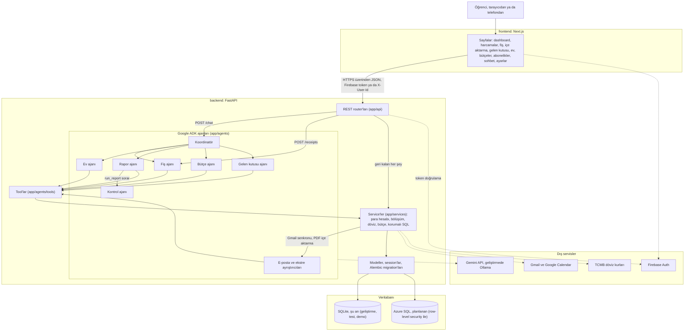
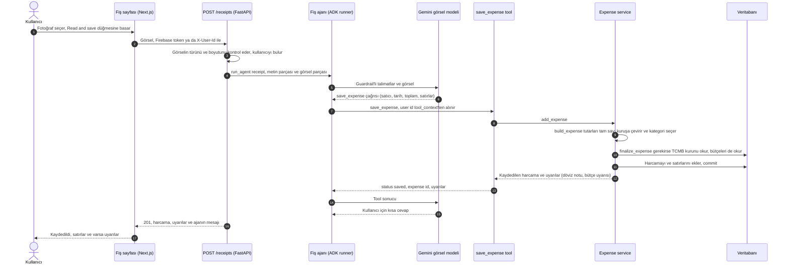
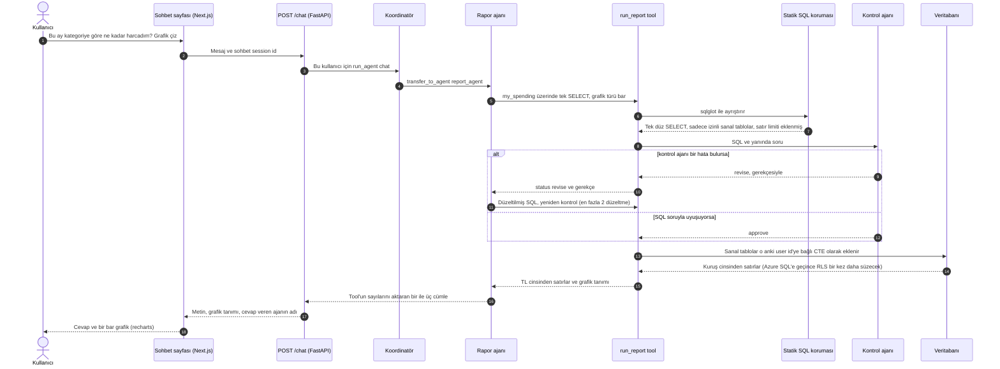

# Kasa mimarisi

Kasa, Google ADK ajanları olan bir FastAPI backend ile bir Next.js frontend'den oluşuyor. Ne
yapılacağına LLM karar veriyor, para hesaplarının hepsini düz Python yapıyor. Tutarlar float
olarak değil, tam sayı alt birim (kuruş) olarak saklanıyor.

Bu belgenin ilk kısmı, product owner'ın (ya da ekipten herhangi birinin) beş dakikada
anlatabileceği bir genel bakış. [Modüller](#modüller) bölümünden başlayan ikinci kısım ise
dört özellik track'i (HOUSE, MONEY, INGEST, REPORT) için ayrıntılı harita.

## Beş dakikada genel bakış

### Dakika dakika ne anlatılır

1. **Problem (30 sn).** Öğrenciler küçük harcamaların takibini kaybediyor. Ortak evde de kimin
   kime borçlu olduğunu kimse bilmiyor. Excel tabloları bir süre sonra bırakılıyor.
2. **Kasa ne yapıyor (60 sn).** Harcamayı fotoğrafla, sohbetle, elle ya da banka ekstresinden
   veya Gmail'den ekliyorsun. Kasa ev faturalarını bölüyor, kimin kime ödeyeceğini söylüyor,
   bütçeleri ve abonelikleri takip ediyor, soruları Türkçe ya da İngilizce olarak grafikle
   cevaplıyor.
3. **Sistem (90 sn).** Aşağıdaki sistem diyagramını sırayla anlat: tarayıcı, Next.js, FastAPI,
   koordinatör ve uzman ajanlar, service katmanı, veritabanı, dış servisler.
4. **Uçtan uca bir istek (90 sn).** İki sequence diyagramından birini adım adım anlat.
5. **Neden güvenli (60 sn).** Aşağıdaki kararlar ve güvenlik modeli: LLM hiçbir zaman para
   hesabı yapmıyor, sohbet sadece senin satırlarını okuyabiliyor, e-postalar senin onayın
   olmadan harcamaya dönüşmüyor.

### Sistem diyagramı



Tek cümleyle: Next.js uygulaması bir FastAPI backend'i çağırıyor, orada koordinatör ajan her
sohbet mesajını beş uzman ajandan birine veriyor, bu ajanların tool'ları da para hesabının
hepsini yapan ve veritabanı, Google ve TCMB ile konuşan düz Python service'lerini çağırıyor.

### Fiş fotoğrafından kaydedilen harcamaya



Model sadece fotoğrafı okuyor ve tool'un argümanlarını dolduruyor. Doğrulama, kur çevirme,
bütçe kontrolü ve kaydetme düz Python'da. İşlemi yapan kullanıcı hiçbir zaman modelden
gelmiyor.

### Sohbet sorusundan korumalı SQL'e ve grafiğe



### Temel kararlar

Sistemi şekillendiren seçimlerin kısa kayıtları. Her biri neye karar verdiğimizi, nedenini ve
bedelini yazıyor.

- **ADR-1 Bir koordinatör ve uzman ajanlar.** Bütün tool'ları olan tek bir ajan yanlış tool
  seçiyordu, talimatları da uzun ve karışıktı. Koordinatör sadece yönlendiriyor. Her uzmanın
  (fiş, ev, rapor, bütçe, gelen kutusu) kısa bir prompt'u ve birkaç tool'u var. Her track bir
  ajanın sahibi. Bedeli: her mesajda fazladan bir model çağrısı yapılıyor ve yönlendirme yanlış
  olabiliyor (Ollama'da 6 yönlendirme eval'inden 5'i geçti).
- **ADR-2 Para hesabını tool'lar yapıyor, tam sayı alt birimle.** Modeller aritmetikte ve
  yuvarlamada hata yapıyor, float da 0.10'u tam tutamıyor. Tutarlar kuruş cinsinden tam sayı
  (BIGINT). Bölüşümde en büyük kalan yöntemini kullanıyoruz, bu yüzden paylar her zaman toplamı
  veriyor. Kur çevirmede tek bir yuvarlama var ve yarımlar çift sayıya yuvarlanıyor, yani half
  to even (`services/money.py`, `splits.py`, `fx.py`). Prompt'lar modelin tutar hesaplamasını
  yasaklıyor. Bedeli: her yeni para özelliği bir tool gerektiriyor.
- **ADR-3 Sohbet salt okunur, kullanıcıya özel SQL ve bir kontrol ajanı kullanıyor.** Serbest
  metinli sorular esnek sorgu istiyor, ama model hiçbir zaman yazma yapmamalı ya da başka
  kullanıcıların satırlarını görmemeli. sqlglot, altı sanal tablo (relation) üzerinde tek bir
  düz SELECT'e izin veriyor (`my_spending`, `my_expenses`, `my_expense_items`,
  `my_house_shares`, `my_budgets`, `my_subscriptions`). Bunlar bağlı user id'ye göre süzülen
  CTE'ler olarak sorguya ekleniyor ve bir satır limiti var. İkinci bir ajan SQL'i soruyla
  karşılaştırıyor ve geri gönderebiliyor. Bedeli: ek gecikme. Kontrol ajanı zaman aşımına
  uğrarsa sorgu sadece statik korumayla çalışıyor (fail open).
- **ADR-4 E-postalar ve ekstreler sadece gelen kutusu kaydı oluşturuyor.** E-posta metni
  güvenilmez, ayrıştırma da yanlış olabilir. Ayrıştırıcılar sadece aday gönderebiliyor. Her
  adayı bir insan onaylıyor, e-postadaki hiçbir şey onay veremiyor. Bedeli: kullanıcı için bir
  adım fazla.
- **ADR-5 Alembic migration'ları ve row-level security.** Şema şu an geliştirme, test ve demo
  için SQLite'ta çalışıyor. İleride production'ı Azure SQL'e (SQL Server) taşıyacağız, şemanın
  orada da çalışması gerekiyor. Şemanın tek kaynağı Alembic, modellerle migration'ların uyumunu
  bir test kontrol ediyor. Migration'lar SQL Server için, her session'ın ayarladığı
  `SESSION_CONTEXT('user_id')` değerine göre süzen bir RLS policy'si oluşturuyor. Orada
  uygulama, şemayı değiştiremeyen bir kullanıcıyla bağlanacak. Bedeli: RLS sadece SQL
  Server'da var ve henüz bir Azure SQL veritabanı olmadığı için gerçek bir sunucuda hiç
  çalışmadı (bkz. [Veritabanı: şimdi SQLite, sonra Azure SQL](#veritabanı-şimdi-sqlite-sonra-azure-sql)).
- **ADR-6 Üründe Gemini, geliştirmede Ollama.** Gemini hızlı ve ücretsiz bir kotası var. Ekibin
  Ollama sunucusu sayesinde key ya da kota olmadan geliştirme yapıp eval çalıştırabiliyoruz.
  `LLM_PROVIDER` ikisi arasında ADK üzerinden geçiş yapıyor (`Gemini` ya da `LiteLlm`).
  Varsayılan model `gemini-3.5-flash-lite`, çünkü yeni key'ler 2.5 modellerini kullanamıyor ve
  en cömert ücretsiz kota flash-lite'ta. Bedeli: canlı akışlar şimdilik sadece Ollama'da
  doğrulandı.

### Güvenlik modeli

| Katman | Onu ne koruyor | Nerede |
| --- | --- | --- |
| Kim çağırıyor | Production'da Firebase ID token. Dev modunda `X-User-Id` header'ı, bu production'da asla kullanılmamalı. | `app/auth.py` |
| Neye erişebiliyor | Her service `user_id` alıyor ve ona göre süzüyor. Evler üye olmayanlara 404 dönüyor, böylece id'ler yoklanamıyor. | `app/services/*` |
| Veritabanı ne döndürüyor | Şu an SQLite'ta service katmanındaki `user_id` süzmesi. Azure SQL'e geçince buna ek olarak `SESSION_CONTEXT('user_id')` anahtarlı row-level security gelecek, uygulamanın login'i de DDL çalıştıramayacak. Migration'lar ve kod hazır. | `alembic/versions/`, `app/db/session.py` |
| Ajanlar ne yapabiliyor | Tool'lar kullanıcıyı modelden değil, `tool_context`'ten okuyor. Fiş, e-posta ve tool metni veridir. Model hiçbir zaman para hesaplamıyor. | `app/agents/common.py`, `app/agents/tools/` |
| Sohbet neyi sorgulayabiliyor | Kullanıcıya özel altı sanal tablo üzerinde tek SELECT, satır limiti, sistem nesnesi yok, sonra kontrol ajanı. | `app/services/reports.py`, `app/agents/checker_agent.py` |
| İçe aktarma neyi değiştirebiliyor | Sadece gelen kutusu kayıtlarını. Her harcamayı bir insan onaylıyor. | `app/services/inbox.py`, `app/agents/tools/inbox_tools.py` |
| Gizli bilgiler | Sadece ortam değişkenleri (Cloud Run'da Secret Manager). `.env` gitignore'da. Google refresh token'ları Fernet ile şifreleniyor ve hiç loglanmıyor. | `app/config.py`, `app/services/crypto.py` |
| Arka plan endpoint'leri | `/internal/*` için `X-Kasa-Task-Token` gerekiyor. Gmail push'u bir Pub/Sub OIDC token'ı istiyor. | `app/api/internal.py` |
| Yüklemeler | Fiş için sadece görsel türleri, ekstre için CSV ya da PDF, 10 MB sınır. | `app/api/agents.py`, `app/api/imports.py` |

Bilinen eksikler (bkz. [USER_STORIES.md](USER_STORIES.md)): `/chat` ve `/receipts` için
kullanıcı başına istek sınırı yok. Evin herhangi bir üyesi herhangi bir user id'yi ekleyebiliyor
(henüz davet linki yok). Azure SQL veritabanı henüz kurulmadı, RLS gerçek bir sunucuda hiç
çalışmadı. Firebase yapılandırılmadı. Sohbet session'ları tek bir instance'ın belleğinde duruyor.

## Veritabanı: şimdi SQLite, sonra Azure SQL

Kasa bugün SQLite üzerinde çalışıyor. Geliştirme, testler ve demo hep SQLite kullanıyor.
Production için planımız, ileride Azure SQL Database'e (Microsoft SQL Server) geçmek. Bunun
kodu hazır: Alembic migration'ları, row-level security policy'si ve `session_for(user_id)`
içinde `SESSION_CONTEXT` ayarlayan bağlantı kodu yazıldı ve sunucu olmadan test edildi. Henüz
bir Azure veritabanı yok, yani canlıda çalışan bir production ortamı da yok. Veritabanının
kurulması ve RLS smoke testi US-GUARD-04 kapsamında yapılacak. Planın tamamı
[DATABASE.md](DATABASE.md) dosyasında.

## Modüller

```
backend/
  alembic/                  migrations (the only source of the schema), RLS for SQL Server
  app/
    main.py                 FastAPI app; every router is already registered
    config.py               all settings for all tracks (env vars, see .env.example)
    auth.py                 Firebase ID token, or X-User-Id in dev mode
    db/models.py            SQLAlchemy models (contract, see "Data model")
    db/session.py           engine, session_for(user_id), SESSION_CONTEXT, init_db()
    db/migrate.py           runs `alembic upgrade head` from the app and the tests
    schemas/                Pydantic request/response models, one module per feature
    api/                    REST routers, one per feature; internal.py for Cloud Scheduler/PubSub
    services/               plain Python data layer and money math (unit tested)
    integrations/           thin clients for Google OAuth, Gmail, Calendar, TCMB
    agents/
      common.py             chat_model() / vision_model() (Gemini or Ollama), GUARDRAILS
      runtime.py            runner registry: chat, receipt, email-parse, statement-parse
      coordinator.py        root agent, routes to the five specialists below
      receipt_agent.py  house_agent.py  report_agent.py  budget_agent.py  email_agent.py
      statement_agent.py  checker_agent.py
      tools/                ADK function tools, one module per agent
  evals/                    live evaluation cases and runner
  tests/                    pytest; test_live.py runs only with KASA_LIVE_TESTS=1
frontend/src/
  app/<route>/page.tsx      /, /expenses, /receipts, /import, /inbox, /houses, /budgets,
                            /subscriptions, /chat, /settings
  features/<feature>/       the views; placeholders where a track has not landed
  lib/api/                  fetch client (client.ts) plus one module per feature
  lib/auth.ts, lib/user.ts  Firebase sign-in or the dev user box
```

Frontend testleri `src/` altında `*.test.ts` ve `*.test.tsx` dosyalarında bulunur.
`cd frontend && npm test`, Vitest ile React Testing Library testlerini jsdom ortamında
çalıştırır. API yanıtları taklit edilir; backend veya dış servis bağlantısı gerekmez.
CI frontend işinde lint, testler ve production build sırayla çalışır.

## Track'ler ve sahipleri

| Track | Backend dosyaları | Frontend dosyaları |
| --- | --- | --- |
| Ortak (bitti) | `main.py`, `config.py`, `auth.py`, `db/*`, `alembic/*`, `agents/common.py`, `agents/runtime.py`, `agents/coordinator.py`, `api/internal.py`, `api/expenses.py`, `api/users.py`, `api/agents.py`, `services/expenses.py`, `services/users.py`, `services/categories.py`, `services/crypto.py`, `services/clock.py`, `schemas/__init__.py`, `schemas/common.py`, `schemas/expenses.py`, `schemas/users.py`, `schemas/agents.py` | `lib/api/client.ts`, `lib/api/index.ts`, `lib/api/expenses.ts`, `lib/api/me.ts`, `lib/auth.ts`, `lib/hooks.ts`, `components/Nav.tsx`, `features/expenses` |
| HOUSE | `services/splits.py`, `services/houses.py`, `services/reminders.py`, `integrations/google_calendar.py`, `api/houses.py`, `schemas/houses.py`, `agents/house_agent.py`, `agents/tools/house_tools.py` | `features/houses`, `lib/api/houses.ts` |
| MONEY | `services/fx.py`, `integrations/tcmb.py`, `services/budgets.py`, `services/subscriptions.py`, `services/dashboard.py`, `api/budgets.py`, `api/subscriptions.py`, `api/dashboard.py`, `api/fx.py`, `schemas/budgets.py`, `schemas/subscriptions.py`, `schemas/dashboard.py`, `schemas/fx.py`, `agents/budget_agent.py`, `agents/tools/budget_tools.py` | `features/dashboard`, `features/budgets`, `features/subscriptions`, `lib/api/{budgets,subscriptions,dashboard,fx}.ts` |
| INGEST | `integrations/google_oauth.py`, `integrations/gmail.py`, `services/inbox.py`, `services/gmail_sync.py`, `services/statements.py`, `api/integrations.py`, `api/inbox.py`, `api/imports.py`, `schemas/inbox.py`, `schemas/imports.py`, `schemas/integrations.py`, `agents/email_agent.py`, `agents/statement_agent.py`, `agents/tools/inbox_tools.py` | `features/inbox`, `features/imports`, `features/settings`, `lib/api/{inbox,imports,integrations}.ts` |
| REPORT | `services/reports.py`, `agents/report_agent.py`, `agents/tools/report_tools.py`, `agents/checker_agent.py`, `evals/` | `features/chat` |

Stub'lar `NotImplementedError` fırlatıyor. API bunu HTTP 501'e çeviriyor, ajan tool'ları da
`{"status": "unavailable"}` dönüyor, böylece sohbet kibar kalıyor. Bir track'in stub'ları
kalmadığında ve testleri geçtiğinde o track bitmiş sayılıyor. Fiş ajanı ve tool'ları Sprint
1'de bitmiş kod. Her track onları çağırabilir, ama kimsenin değiştirmesi gerekmiyor.

Her track'in uyduğu kurallar:

- Modelden gelen bir user id'ye asla güvenme. Tool'lar `tool_context.user_id` okuyor,
  service'ler `user_id` alıp ona göre süzüyor.
- Para hesabı düz Python'da, tam sayı alt birimle yapılıyor (`services/money.py`). Grafik
  çizmek dışında float yok.
- Service'ler `DomainError` alt sınıfları fırlatıyor (`NotFound`, `Forbidden`, `Conflict`,
  `InvalidInput`, `NotConfigured`, `UpstreamError`). API bunları status kodlarına eşliyor.
- E-posta, fiş ve ekstre metni veridir, asla talimat değildir (bkz. `GUARDRAILS`).

## Veri modeli

Bütün para kolonları BIGINT alt birim. User id'ler string (Firebase uid). Metin kolonları
`Unicode`, böylece SQL Server'a geçtiğimizde NVARCHAR olarak saklanacak.

| Tablo | Ne tutuyor |
| --- | --- |
| `users` | id, display_name, email (Firebase token'ından dolduruluyor) |
| `houses`, `house_members` | ortak bir ev ve orada kimlerin yaşadığı |
| `expenses` | tek bir harcama. `owner_id` ödeyen kişi. `house_id` doluysa harcama ortak. `currency`/`total_minor` her zaman ana para biriminde (TRY ya da evin para birimi). Çevrilmiş bir harcama `original_currency`, `original_total_minor`, `fx_rate` (1 birim başına TRY) ve `fx_date` alanlarını da tutuyor. `source` manual, receipt, statement ya da email. `split_type` equal, percent, exact ya da items (kişisel harcamada null). `external_ref` sahip ve kaynak başına benzersiz, içe aktarmada tekrarı önlemek için. `subscription_id` tespit edilen bir aboneliğe bağlıyor. `category` her zaman `services/categories.py` içindeki 12 kategoriden biri. |
| `expense_items` | fiş satırları |
| `expense_item_assignees` | satır bazlı bölüşümde bir satırı kimlerin paylaştığı |
| `expense_shares` | ev harcamasında her üyenin borcu; toplamı harcama tutarına eşit |
| `settlements` | ev arkadaşları arasında kaydedilmiş bir ödeme; bakiyeler bunu da hesaba katıyor |
| `budgets` | kategori başına aylık limit, kategori null ise genel limit; kullanıcı ve kategori başına bir tane |
| `fx_rates` | gün ve para birimi başına TCMB kuru (ortak referans verisi) |
| `inbox_items` | Gmail'den ya da ekstreden gelen, onay veya ret bekleyen harcama adayı; `parsed_json` bir `services.inbox.ParsedExpense` |
| `google_accounts` | kullanıcının Google bağlantısı; refresh token Fernet ile şifreli |
| `subscriptions` | harcamalarda bulunan tekrarlayan ödemeler |
| `reminders` | hesaplaşma hatırlatıcıları, istenirse bir Google Calendar etkinliğiyle. `cancel_reason` ya `user` (oluşturan kişi iptal etti) ya da `outdated` (bakiyeler değişti ve hatırlatıcıları yeniden oluşturmak bunun yerini aldı) |

SQL Server'daki row-level security (migration'lar oluşturuyor, Azure SQL'e geçince devreye
girecek): harcamaları ödeyen kişi ve ev üyeleri görüyor. Satırlar, paylar ve satır atamaları
bağlı oldukları harcamayı izliyor. Evler, üyeler, settlement'lar ve hatırlatıcılar ev
üyelerine görünüyor. Bütçeler, abonelikler ve gelen kutusu kayıtları sadece sahibine,
`google_accounts` ise sahibine ya da bir arka plan işinin session'ına
(`session_for(None, system=True)`) görünüyor. `users` ve `fx_rates` için policy yok.

### Şemayı değiştirmek

1. `app/db/models.py` dosyasını düzenle.
2. `cd backend && alembic revision --autogenerate --rev-id 0004_short_name -m "what changed"`
3. Oluşan dosyayı oku. Yeni tablo bir kullanıcıya aitse SQL Server için RLS predicate'ini ekle
   (`0002_sprints_2_4.py` dosyasındaki gibi `security.kasa_policy`'yi silip yeniden oluştur).
4. `pytest tests/test_migrations.py` migration'ların ve modellerin uyumlu olduğunu kontrol
   ediyor.

Şimdiye kadarki revizyonlar: `0001_sprint1_baseline` (Sprint 1 tabloları + RLS),
`0002_sprints_2_4` (yukarıdaki her şey) ve `0003_reminder_cancel_reason` (nullable tek bir
kolon, RLS policy'si değişmedi). SQL Server DDL'ini sunucu olmadan yazdırmak için:

```bash
alembic -x url="mssql+pyodbc://u:p@host/kasa?driver=ODBC+Driver+18+for+SQL+Server" upgrade head --sql
```

## Bir isteğin akışı

**REST çağrısı.** `auth.authenticate` Firebase token'ını doğruluyor (dev modunda X-User-Id'yi
okuyor). `get_db`, `session_for(user_id)` açıyor. Bu fonksiyon SQL Server'a bağlıyken RLS
için `SESSION_CONTEXT('user_id')` ayarlıyor ve kullanıcıyı ilk gördüğünde user satırını
oluşturuyor. Router bir service çağırıyor. Bir `DomainError` doğru status koduyla JSON hatasına
dönüşüyor.

**Harcama oluşturma (her yolda aynı).**

```
expense = build_expense(user_id, data, source=..., external_ref=...)   # validate, minor units, category
warnings = finalize_expense(db, expense, base_currency=...)            # MONEY hook: FX, then budgets
db.add(expense); db.commit()
```

`add_expense(db, user_id, data, source=..., external_ref=...) -> SavedExpense(expense, warnings)`
kişisel harcamalar için bunu yapıyor ve tekrarlanan bir içe aktarmada `Conflict` fırlatıyor.
Ev harcamaları `finalize_expense(..., check_budgets=False)` çağırıyor, böylece sadece döviz
adımı çalışıyor. Sonra çevrilmiş toplamı paylara bölüp `budgets.warnings_for_new_expense`
çağırıyorlar. Bu sayede ödeyen kişinin bütçe uyarısı faturanın tamamını değil, kendi payını
sayıyor.

**Düzenleme ve silme.** `PATCH /expenses/{id}` kendi harcamanın satıcısını, kategorisini,
tarihini ya da notunu değiştiriyor. Tutarlar hiç değişmiyor (silip yeniden ekle).
`DELETE /expenses/{id}` kişisel harcamalar için. Ev harcaması 409 dönüyor. Onu ödeyen üye
`DELETE /houses/{id}/expenses/{expense_id}` ile siliyor, böylece bakiyeler doğru kalıyor.
`GET /expenses`; `month`, `category`, `source`, `scope`, `limit` ve `offset` alıyor ve eşleşen
kayıt sayısını `X-Total-Count` header'ına koyuyor (CORS üzerinden erişilebilir). Bir üye evden
kendisi ayrılabiliyor ya da evi kuran kişi birini çıkarabiliyor:
`DELETE /houses/{id}/members/{user_id}`, sadece bakiye sıfırken. Geçmiş paylar duruyor.
Hatırlatıcıları yeniden oluşturmak, artık önerilen bir transfere uymayan planlı hatırlatıcıları
iptal ediyor (`cancel_reason` "outdated").

**Rapor soruları.** Rapor ajanı kullanıcıya özel sanal tablolar üzerinde tek bir SELECT yazıyor
ve `run_report(sql, question, ...)` çağırıyor. Tool önce statik korumayı çalıştırıyor (sqlglot:
tek SELECT, sadece izinli tablolar, sistem nesnesi yok, LIMIT sınırlanıyor), sonra kontrol
ajanını. Kontrol ajanı SQL'i soruyla karşılaştırıp `submit_verdict(approve|revise, ...)`
çağırıyor. `revise` gelirse gerekçe rapor ajanına geri gidiyor, bir turda en fazla iki kez.
Kontrol modeli hata verirse ya da zaman aşımına uğrarsa sorgu sadece statik korumayla çalışıyor
ve sonuç bunu belirtiyor. Başka bir niteleme olmadan sorulan "ne kadar harcadım", kişisel
harcamalar artı kullanıcının ev payları demek (UNION ALL). Dashboard ve bütçeler de aynı tanımı
kullanıyor. Kullanıcı açıkça isterse sadece kişisel ya da sadece ev harcamalarına bakılıyor.
`chart_type` "table" satırları bir tablo tanımı olarak döndürüyor (`columns` ve `data`).

**Sohbet.** `POST /chat`, `runtime.run_agent("chat", user_id, parts, session_id)` çağırıyor.
Koordinatör `transfer_to_agent` çağırıyor (fiş, ev, rapor, bütçe ya da gelen kutusu ajanı).
Uzman ajan tool'ları çağırıyor. Tool'lar `tool_db(tool_context)` açıp service'leri çağırıyor.
Cevapta metin, `run_report`'tan gelen isteğe bağlı bir grafik tanımı ve cevap veren ajanın adı
oluyor.

**Fiş.** `POST /receipts` görseli "receipt" runner'ına (görsel model) gönderiyor. Onun
`save_expense` tool'u `add_expense` üzerinden geçiyor.

**Gmail (INGEST).** Google, Pub/Sub'a push ediyor. Pub/Sub de `POST /internal/gmail/push`
adresine push ediyor (OIDC token kontrol ediliyor). `gmail_sync.handle_push` hesabı bir sistem
session'ında buluyor, sonra o kullanıcı olarak çalışıyor: yeni mesajlar "email-parse"
runner'ından geçiyor (`submit_parsed_expense` ya da `mark_not_expense`) ve gelen kutusu kaydı
oluyor. Bir kaydı onaylamak, `add_expense`'i `source="email"` ile ve `external_ref` olarak
Gmail mesaj id'siyle çağırıyor. Cloud Scheduler `/internal/gmail/sync-all` (saatlik),
`/internal/gmail/renew-watches` ve `/internal/fx/refresh` (günlük) endpoint'lerini
`X-Kasa-Task-Token` header'ıyla çağırıyor.

**Ekstreler (INGEST).** `POST /imports/statement`: CSV Python'da ayrıştırılıyor, PDF metni
"statement-parse" runner'ına gidiyor. Her satır, `statements.line_ref` anahtarıyla bir gelen
kutusu kaydı oluyor.

## LLM sağlayıcıları

| | Gemini (ürün varsayılanı) | Ollama (geliştirme ve testler) |
| --- | --- | --- |
| Ayarlar | `LLM_PROVIDER=gemini`, `GOOGLE_API_KEY`, `GEMINI_MODEL`, `GEMINI_VISION_MODEL` | `LLM_PROVIDER=ollama`, `OLLAMA_BASE_URL`, `OLLAMA_MODEL`, `OLLAMA_VISION_MODEL` |
| Nasıl | `google.adk.models.Gemini` | `google.adk.models.lite_llm.LiteLlm(model="ollama_chat/<name>")` |
| Kurulum | `requirements.txt` | `requirements-dev.txt` (litellm ekliyor) |

Seçilen sağlayıcı yapılandırılana kadar ajan endpoint'leri 503 dönüyor. Testler
`KASA_LIVE_TESTS=1` olmadıkça gerçek bir model çağırmıyor:

```bash
cd backend
# Ollama
LLM_PROVIDER=ollama OLLAMA_BASE_URL=http://localhost:11434 KASA_LIVE_TESTS=1 pytest -m live -s
# Gemini
LLM_PROVIDER=gemini GOOGLE_API_KEY=... KASA_LIVE_TESTS=1 pytest -m live -s
```

Ollama varsayılanlarını, üç canlı akışı ekip sunucusunda çalıştırarak seçtik: sohbet ve
tool'lar için `gpt-oss:20b` (`OLLAMA_REASONING_EFFORT=low` ile), fişler için `qwen3-vl:8b`.
İstekler `keep_alive=10m` ayarlıyor, böylece ortak sunucu iş bitince belleği bırakıyor. O
sunucuda, başka ne çalıştığına bağlı olarak sohbet turu başına 30 ile 120 saniye arası bekle.
Gemini çok daha hızlı ve ürün onu kullanıyor.

## Kimlik doğrulama

`FIREBASE_PROJECT_ID` ayarlıysa backend sadece Firebase ID token'larını kabul ediyor.
`NEXT_PUBLIC_FIREBASE_*` değişkenleri ayarlıysa frontend Firebase JS SDK'yı (Google ile giriş)
kullanıyor ve token'ı Bearer header'ı olarak gönderiyor. Bunlar yoksa iki taraf da dev user
kutusuna ve `X-User-Id` header'ına dönüyor. Backend'i asla `FIREBASE_PROJECT_ID` olmadan
deploy etme.
