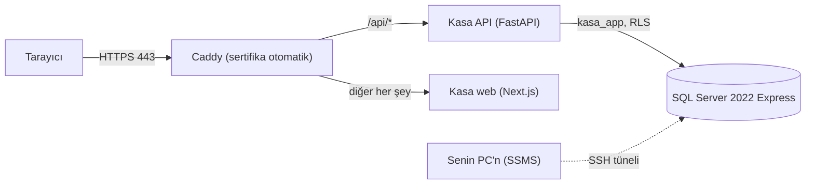

# Kasa'yı DigitalOcean'da çalıştırmak

Kasa tek bir DigitalOcean sunucusunda (Droplet) çalışıyor: SQL Server 2022, backend, web arayüzü
ve HTTPS için Caddy, hepsi Docker içinde. Veritabanı gerçek bir SQL Server olduğu için
migration'lar ve row-level security olduğu gibi çalışıyor. Kendi bilgisayarından SSMS ile de
bağlanabiliyorsun.

Dosyalar: [`deploy/digitalocean/`](../deploy/digitalocean/). Veritabanı planının tamamı
[DATABASE.md](DATABASE.md) içinde.



## 1. Ne kadar tutar

| Droplet | Fiyat | Not |
| --- | --- | --- |
| Basic, 2 GB RAM, 1 vCPU | ayda yaklaşık 12 dolar | En küçüğü. SQL Server en az 2 GB istiyor, script ek olarak 2 GB swap açıyor. |
| Basic, 4 GB RAM, 2 vCPU | ayda yaklaşık 24 dolar | Önerilen. Build ve sohbet daha rahat. |

SQL Server **Express** sürümü ücretsiz (veritabanı başına 10 GB sınırı var, Kasa için fazlasıyla
yeter). Row-level security Express'te de var.

GitHub Student Pack'teki DigitalOcean kredisi 200 dolar ve aktive edildiği günden itibaren bir
yıl geçerli. Kalanı **Billing > Credits** sayfasında görünüyor. Kredi biterse kart tanımlı
değilse sunucu durur; demo öncesi kontrol et.

## 2. SSH anahtarı (bir kere)

Şifre yerine anahtarla girmek daha güvenli. Windows PowerShell'de:

```powershell
ssh-keygen -t ed25519 -C "kasa"
Get-Content $env:USERPROFILE\.ssh\id_ed25519.pub
```

Çıkan satırı kopyala. DigitalOcean'da **Settings > Security > SSH Keys > Add SSH Key**'e yapıştır.

## 3. Droplet'i oluştur

DigitalOcean'da **Create > Droplets**:

- **Region:** Frankfurt (FRA1) ya da Amsterdam (AMS3), Türkiye'ye en yakınlar.
- **Image:** Ubuntu 24.04 (LTS) x64.
- **Size:** Basic, Regular, 4 GB / 2 CPU (ya da 2 GB, yukarıdaki tabloya bak).
- **Authentication:** SSH Key, 2. adımdaki anahtar.
- **Hostname:** `kasa`.
- İsteğe bağlı: **Backups** (haftalık sunucu yedeği, fiyata yüzde 20 ekliyor).

**Create Droplet**'e bas, IP adresini kopyala.

## 4. Kurulum (tek komut)

```powershell
ssh root@SUNUCU_IP
```

Sunucuda:

```bash
curl -fsSL https://raw.githubusercontent.com/berkekcay/Kasa-Expense-Agent/main/deploy/digitalocean/setup.sh -o setup.sh
less setup.sh      # ne yaptığını oku, q ile çık
bash setup.sh
```

Script Docker'ı kuruyor, 2 GB swap açıyor, güvenlik duvarında sadece SSH, 80 ve 443'ü açık
bırakıyor, kodu `/opt/kasa`'ya indiriyor, parolaları ve anahtarları üretip
`/opt/kasa/deploy/digitalocean/.env` dosyasına yazıyor ve her şeyi başlatıyor. İlk build birkaç
dakika sürüyor. Sonunda `https://<ip-tireli>.sslip.io` adresini yazıyor: alan adı almadan
gerçek bir HTTPS sertifikası veren ücretsiz bir servis. Kendi alan adın varsa bir A kaydını IP'ye
yönlendir ve `.env` içinde `DOMAIN=` satırını değiştir.

Gemini anahtarını ekle (sohbet ve fiş okuma için):

```bash
nano /opt/kasa/deploy/digitalocean/.env      # GOOGLE_API_KEY=... yaz, Ctrl+O, Enter, Ctrl+X
cd /opt/kasa/deploy/digitalocean && docker compose up -d
```

`.env` dosyası sadece sunucuda duruyor, repoya girmiyor. İçindekileri gruba, issue'ya ya da
ekran görüntüsüne koyma.

## 5. Demo verisi ve giriş

```bash
cd /opt/kasa/deploy/digitalocean
docker compose run --rm api python -m scripts.seed_demo --user demo
```

Komut sonunda demo hesabının e-postasını, şifresini ve Google Authenticator için bir QR kodu
yazıyor. Siteyi aç, bu bilgilerle gir. Kendi hesabını açmak için de **Register** yeterli.

## 6. Kendi bilgisayarından SSMS ile bağlanmak

SQL Server'ın 1433 portu internete açık değil (bilerek). Bilgisayarından bir SSH tüneliyle
bağlanıyorsun. Bilgisayarında başka bir SQL Server 1433'ü kullanıyor olabilir, o yüzden yerelde
14330 kullanıyoruz.

1. Parolaları sunucudan oku: `grep PASSWORD /opt/kasa/deploy/digitalocean/.env`
2. Bilgisayarında bir PowerShell penceresi aç ve açık bırak:

   ```powershell
   ssh -N -L 14330:localhost:1433 root@SUNUCU_IP
   ```

3. SSMS'te:
   - **Server name:** `localhost,14330`
   - **Authentication:** SQL Server Authentication
   - **Login:** `sa` (yönetici) ya da `kasa_app` (uygulamanın kullanıcısı)
   - **Encryption:** Mandatory, **Trust server certificate** işaretli
4. Veritabanı: `kasa`.

**Row-level security'yi görmek:** RLS herkese uygulanıyor, `sa`'ya bile. Kullanıcı tabloları
(harcamalar, bütçeler, ev) oturuma bir kullanıcı söylenmeden boş görünür. Bu bir hata değil,
güvenliğin kendisi:

```sql
USE kasa;
SELECT id, display_name, login_email FROM users;      -- users tablosunda RLS yok
SELECT COUNT(*) FROM expenses;                         -- 0: oturumda kullanıcı yok
EXEC sp_set_session_context @key = N'user_id', @value = N'demo';
SELECT TOP 10 merchant, total_minor, expense_date FROM expenses ORDER BY expense_date DESC;
```

Demoda hocaya göstermek için iyi bir an: aynı sorgu, farklı `user_id` ile farklı satırlar.

## 7. Güncelleme

Yeni kod main'e girince sunucuda:

```bash
cd /opt/kasa && git pull --ff-only
cd deploy/digitalocean && docker compose up -d --build
```

Migration'lar `migrate` servisiyle otomatik çalışıyor (`alembic upgrade head`, `sa` ile), sonra
API yeniden başlıyor. `bash /opt/kasa/deploy/digitalocean/setup.sh` de aynı işi yapıyor ve
`.env`'ye dokunmuyor.

## 8. Yedek ve geri yükleme

Her gece 03:30'da tam yedek alınıyor, son 7 tanesi tutuluyor:
`/opt/kasa/deploy/digitalocean/backups/`. Elle yedek: `bash backup.sh`. Ara sıra bilgisayarına
kopyala:

```powershell
scp root@SUNUCU_IP:/opt/kasa/deploy/digitalocean/backups/kasa-*.bak .
```

Geri yükleme (API'yi durdurup):

```bash
cd /opt/kasa/deploy/digitalocean
docker compose stop api
set -a; . ./.env; set +a
docker compose exec mssql /opt/mssql-tools18/bin/sqlcmd -C -S localhost -U sa -P "$MSSQL_SA_PASSWORD" \
  -Q "RESTORE DATABASE kasa FROM DISK = N'/var/opt/mssql/backup/kasa-YYYYMMDD-HHMM.bak' WITH REPLACE"
docker compose up -d
```

## 9. Güvenlik notları

- Açık portlar sadece 22 (SSH), 80 ve 443. SQL Server sadece sunucunun içinden ve SSH tüneliyle.
- Uygulama `kasa_app` ile bağlanıyor: şema değiştiremiyor, `alembic_version`'a yazamıyor, her
  sorgusu RLS'den geçiyor. Migration'ları sadece `sa` çalıştırıyor.
- Parolalar ve anahtarlar sadece sunucudaki `.env` dosyasında (izin 600).
- İstersen DigitalOcean'da **Networking > Firewalls** ile bir Cloud Firewall da tanımla, SSH'ı
  sadece ekibin IP'lerine aç.
- `sa` parolasını değiştirirsen `.env`'yi de güncelle, yoksa migration çalışmaz.

## 10. Sorun giderme

| Belirti | Çözüm |
| --- | --- |
| `docker compose ps` içinde mssql sürekli yeniden başlıyor | RAM yetmiyor. `free -h` ile bak; 2 GB Droplet'te swap açık mı kontrol et ya da 4 GB'a büyüt. Log: `docker compose logs mssql`. |
| Site açılmıyor, sertifika hatası | Caddy sertifikayı alamadı. `docker compose logs caddy`. Alan adının A kaydı IP'yi gösteriyor mu, 80 ve 443 açık mı bak. |
| `migrate` başarısız | `docker compose logs migrate`. Genelde `sa` parolası `.env` ile uyuşmuyor. |
| `Login failed for user 'kasa_app'` | `docker compose up -d` tekrar çalıştır: `db-init` parolayı `.env`'ye göre günceller. |
| Sohbet "Chat is off" diyor | `.env` içinde `GOOGLE_API_KEY` boş. Ekleyip `docker compose up -d`. |
| Build sırasında "killed" | Bellek yetmedi. Swap'ı kontrol et ya da Droplet'i büyüt. |
